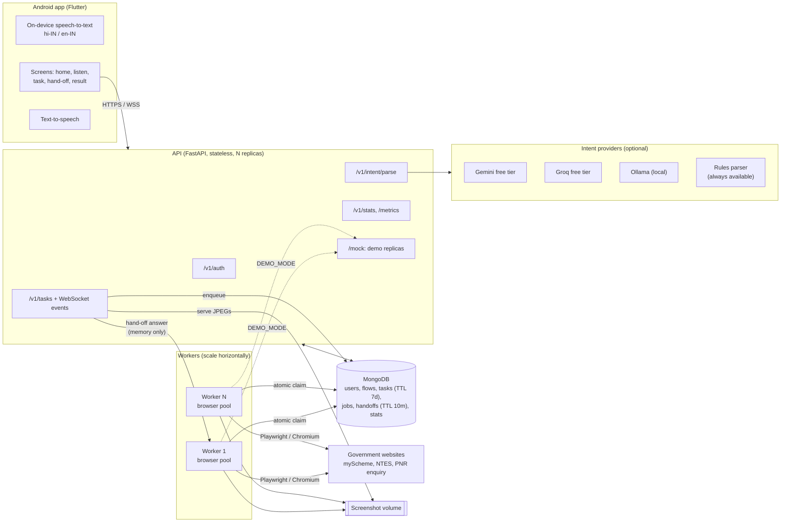
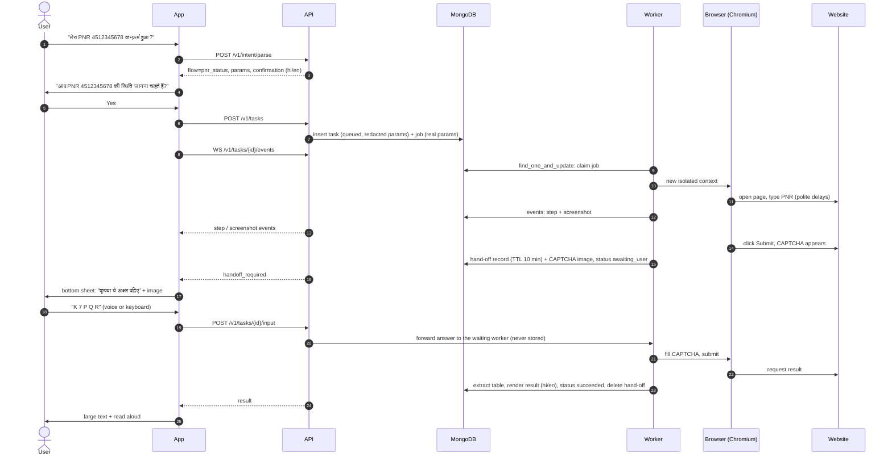
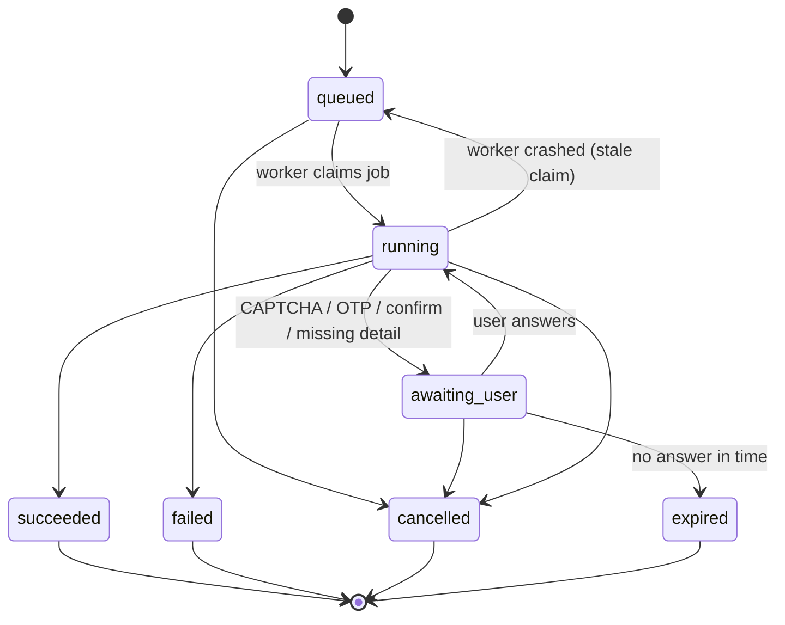

# Architecture

Sahayak has three moving parts: a **stateless API**, one or more **workers** that drive a real
browser, and **MongoDB**, which holds tasks, the job queue and short-lived hand-off records.
The phone app talks only to the API.

## System overview

## A task, end to end (including a CAPTCHA hand-off)

## Task status machine

Transitions are enforced in `TaskService.set_status` with a conditional update: a status only
changes if the current status allows it, so racing writers cannot corrupt a task.

## Flows: saved routes as data

A flow (`backend/app/flows/definitions/*.json`) is a declarative list of steps: `goto`, `fill`,
`click`, `select`, `press`, `wait_for`, `extract`, `screenshot`, `ask_user`, `if_exists`,
`assert`, `narrate`, `pause`, `fail`. Adding a website is a JSON file plus a mock replica,
with no new code. Each flow is validated against a JSON Schema and semantic rules when it loads:
- template variables must exist;
- CAPTCHA and OTP steps must hand over to the user;
- a state-changing click must follow a `confirm` hand-off.

See [adding-a-flow.md](adding-a-flow.md).

The runner (`app/flows/runner.py`) only talks to a `BrowserEngine` interface:
- `PlaywrightEngine` (default) runs local headless Chromium, with a fresh isolated context per task.
- `TinyFishEngine` (optional, only with `TINYFISH_API_KEY`) runs flows that define a
  natural-language `goal` and need no hand-off. CAPTCHA and OTP flows always stay on Playwright.

## How it scales

| Concern | Design |
|---|---|
| API | Stateless (JWT auth, no sessions). Run as many replicas as needed behind a load balancer. |
| Workers | Independent processes: `docker compose up --scale worker=3`. Each worker has a browser pool of `WORKER_CONCURRENCY` isolated contexts (default 2). |
| Queue | `JobQueue` interface. `MongoJobQueue` claims atomically with `find_one_and_update`, sends heartbeats while working, and re-queues claims from crashed workers after `JOB_CLAIM_TIMEOUT_S`. A Redis (or SQS) implementation drops in behind the same 7 methods. |
| Politeness | Per-site concurrency limit (`PER_SITE_CONCURRENCY`, default 2 per worker), randomised 250–700 ms pauses between actions, an honest user agent, and no retries beyond 2 per step. |
| Realtime | The WebSocket tails the task document, so any API replica can serve any task. Clients fall back to polling `GET /v1/tasks/{id}` if the socket drops. |
| Hand-offs | Answers go API → worker over the worker's internal HTTP port (shared-secret header), or in memory when the worker is embedded. Nothing is persisted, so any API replica can deliver to any worker. |
| Flows | Loaded once, validated and cached in memory; also synced to Mongo for inspection. |
| Stats | Durable per-flow counters in a tiny `stats` collection; `/metrics` builds Prometheus output from Mongo, so it is correct across all processes. |
| Stage safety | `DEMO_MODE=true` routes every flow to bundled mock replicas that mirror the live pages, so the same steps run without internet. |
| Cost | ₹0: Mongo (Docker or Atlas M0), on-device speech, free-tier or local LLMs, or no LLM at all. |

Rough capacity estimate (not load-tested): a flow takes 5–30 s on a live site, mostly
spent waiting on the website, plus however long the user takes at a hand-off. A worker with
2 contexts can therefore finish a few flows a minute. Capacity grows linearly with workers
(each Chromium context needs roughly 150–250 MB), and the per-site limits keep the load on
each government site small.

## Data and privacy

| Collection | Contents | Retention |
|---|---|---|
| `users` | device id, language, timestamps. No name, phone or email. | until "Delete my data" |
| `tasks` | flow, **redacted** params (PNR shown as `••••••5678`), events, result | TTL index: 7 days |
| `jobs` | queue state; real params live here only until the job finishes | params removed on finish; TTL 7 days |
| `handoffs` | kind, prompt, CAPTCHA image id. **Never the answer.** | TTL index: 10 minutes; deleted when answered |
| `stats` | per-flow counters, no personal data | kept |
| screenshots | small JPEGs on a volume | deleted with the task (worker sweep runs every minute) |

Logs pass through a redaction filter that masks 10-digit numbers (PNRs, phones), Aadhaar-like
IDs, emails, JWTs and the values of keys such as `otp`, `captcha` and `password`.
